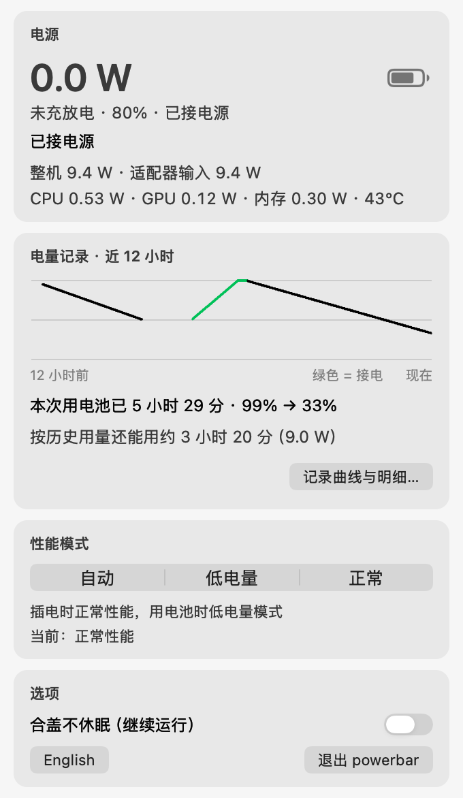
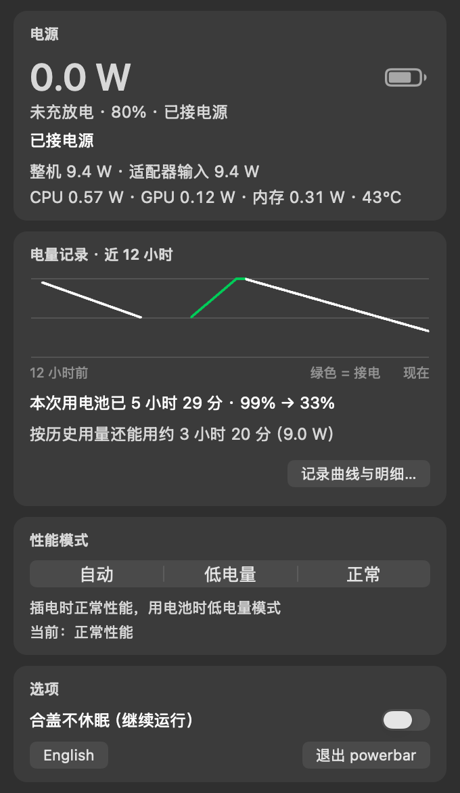
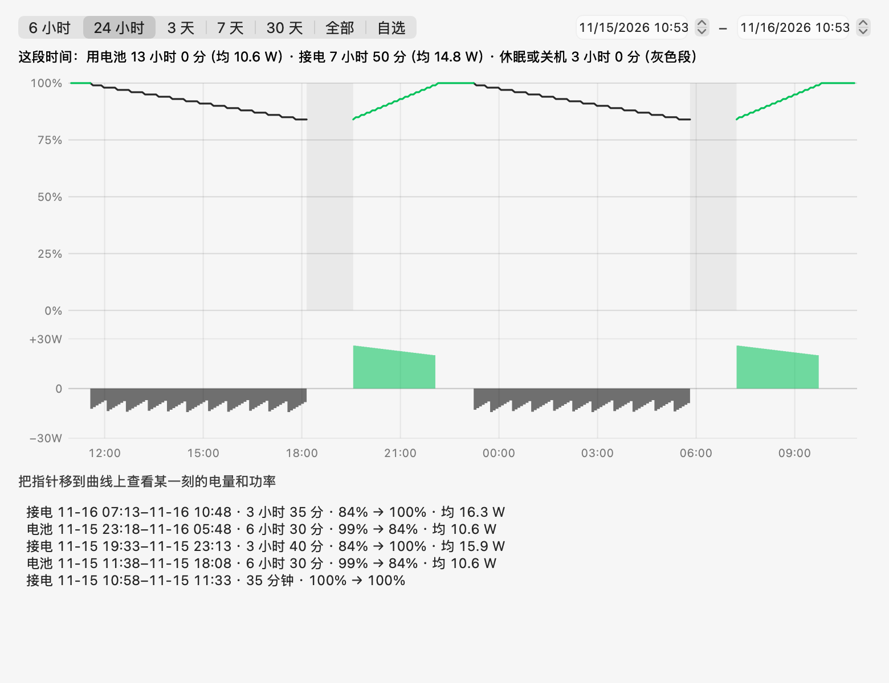

# powerbar for Apple Silicon Macs

菜单栏电源面板：电池充放电功率、整机功耗、SoC（CPU / GPU / ANE / 内存）功耗和温度，充放电历史与续航估计，低电量模式切换，合盖不休眠。

A menu-bar power panel for Apple Silicon Macs: battery charge/discharge power, whole-system power, SoC power (CPU / GPU / ANE / DRAM) and temperature, charge history with a time-left estimate from your usual consumption, a Low Power Mode switch and "keep running with the lid closed".

Sister tool of the powerbar in [MECHREVO-WUJIE15XA-8745HS-Hackintosh](https://github.com/QiRanChenk/MECHREVO-WUJIE15XA-8745HS-Hackintosh) (AMD Hackintosh version).

| Light | Dark |
|---|---|
|  |  |



## 功能 / Features

- **电源**：菜单栏显示电池功率（`⚡︎+12.3W` 充电 / `-8.1W` 放电）；面板里有电量、预计剩余或充满时间、整机功耗（`PowerTelemetryData.SystemLoad`）、适配器输入、IOReport "Energy Model" 的 CPU / GPU / ANE / DRAM 功耗、最热的 `PMU tdie` 温度。
- **电量记录**：每 5 分钟记一条到 `~/Library/Application Support/powerbar/history.csv`（保留 60 天），近 12 小时曲线（绿色 = 接电），本次用电池 / 接电时长，按近 14 天的常用功耗（去掉首尾 10%）估计续航。
- **记录窗口**：6 小时 / 24 小时 / 3 天 / 7 天 / 30 天 / 全部 / 自选区间的电量与功率曲线，灰色段 = 休眠或关机，指针悬停看读数，每段充放电明细。
- **性能模式**：自动（插电正常、电池低电量模式）/ 始终低电量 / 始终正常，由 root 服务 `pbd` 用 `pmset` 应用。
- **合盖不休眠**：`pmset -a disablesleep 1/0`。
- 中文 / English 切换，深色模式。

## 安装 / Install

需要 Xcode Command Line Tools（`xcode-select --install`）。

```bash
git clone https://github.com/QiRanChenk/powerbar-mac.git
cd powerbar-mac
bash install.sh      # 编译、安装登录项 powerbar 和 root 服务 pbd（会要一次管理员密码）
```

- `powerbar` → `~/.local/bin/powerbar`，LaunchAgent `local.powerbar`
- `pbd.sh` → `/usr/local/libexec/pbd.sh`，LaunchDaemon `local.pbd`；它只读 `/Users/Shared/powerbar/mode` 和 `lid` 两个文件

卸载 / Uninstall: `bash uninstall.sh`（关掉合盖不休眠，低电量模式设置保持不变）。

## 截图工具 / Snapshot

```bash
powerbar --snapshot panel.png [dark]          # 面板（历史不足时用示例数据）
powerbar --snapshot-records rec.png [dark]    # 记录窗口（示例数据）
```

## 说明 / Notes

用到了私有接口（`libIOReport`、`IOHIDEventSystemClient`），macOS 更新后可能需要调整。只在 Apple M3 Pro / macOS 26 上测过。

Uses private APIs (`libIOReport`, `IOHIDEventSystemClient`). Tested on an Apple M3 Pro with macOS 26 only.

## License

MIT
